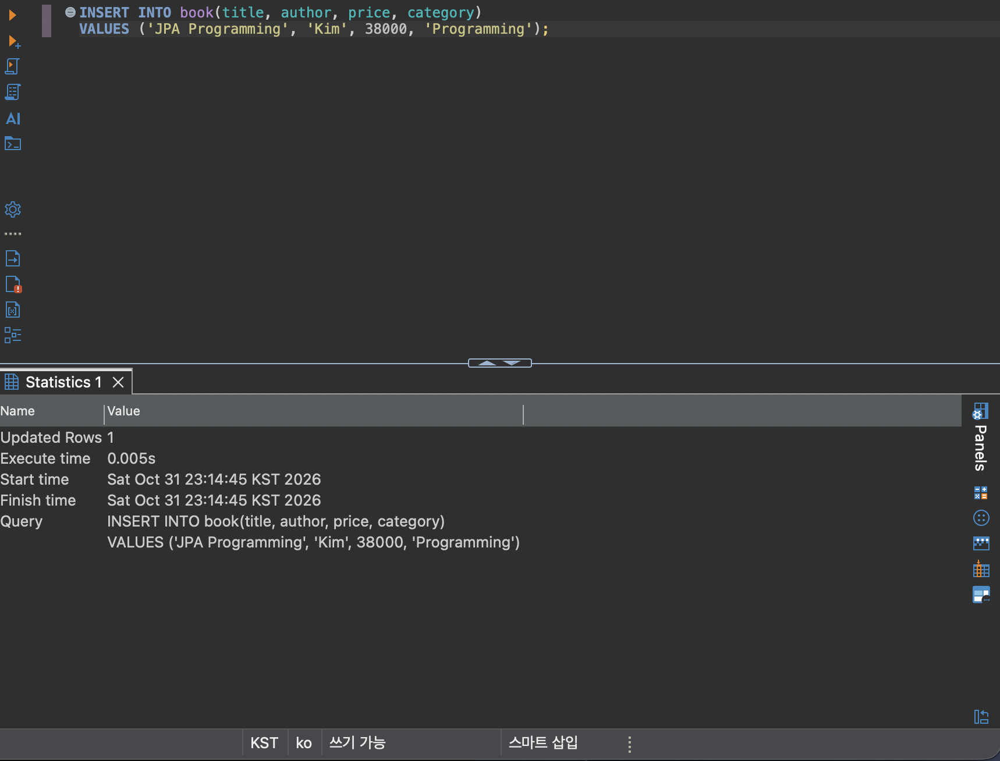
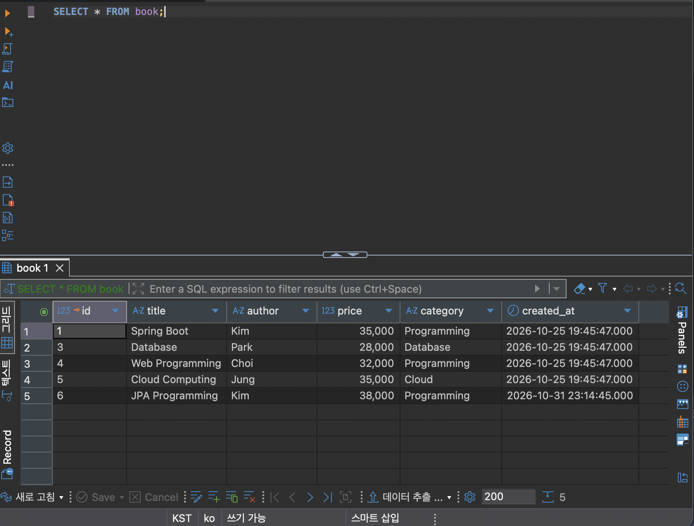
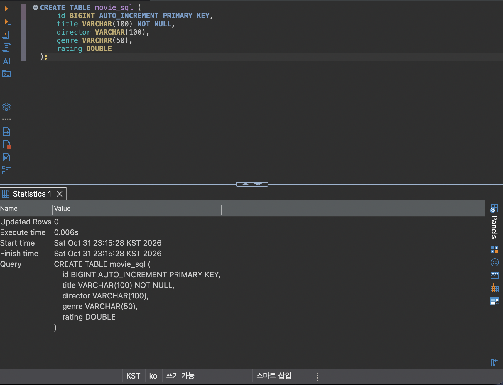
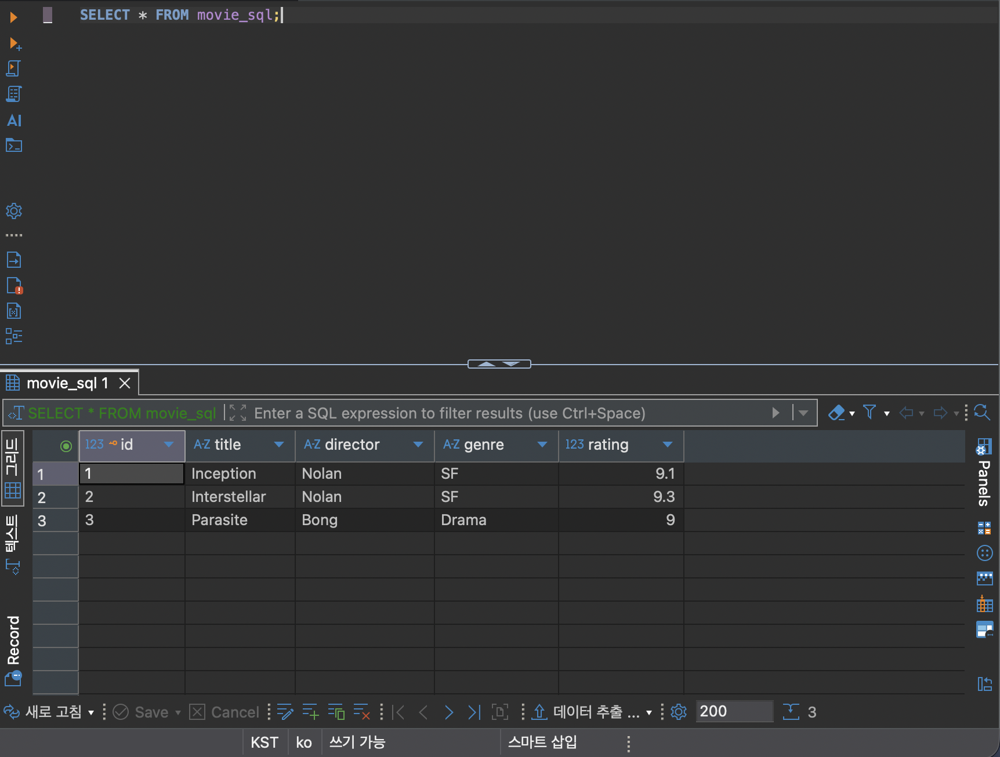
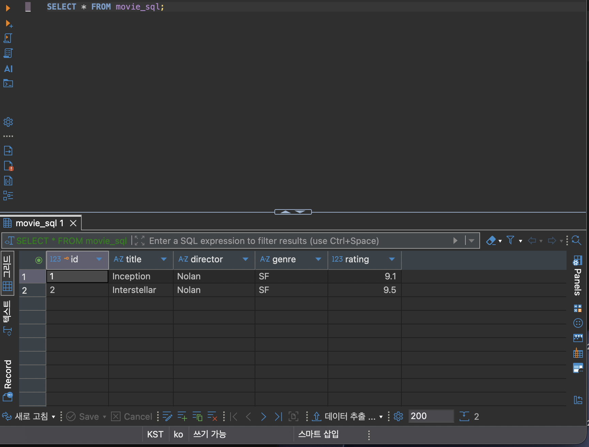
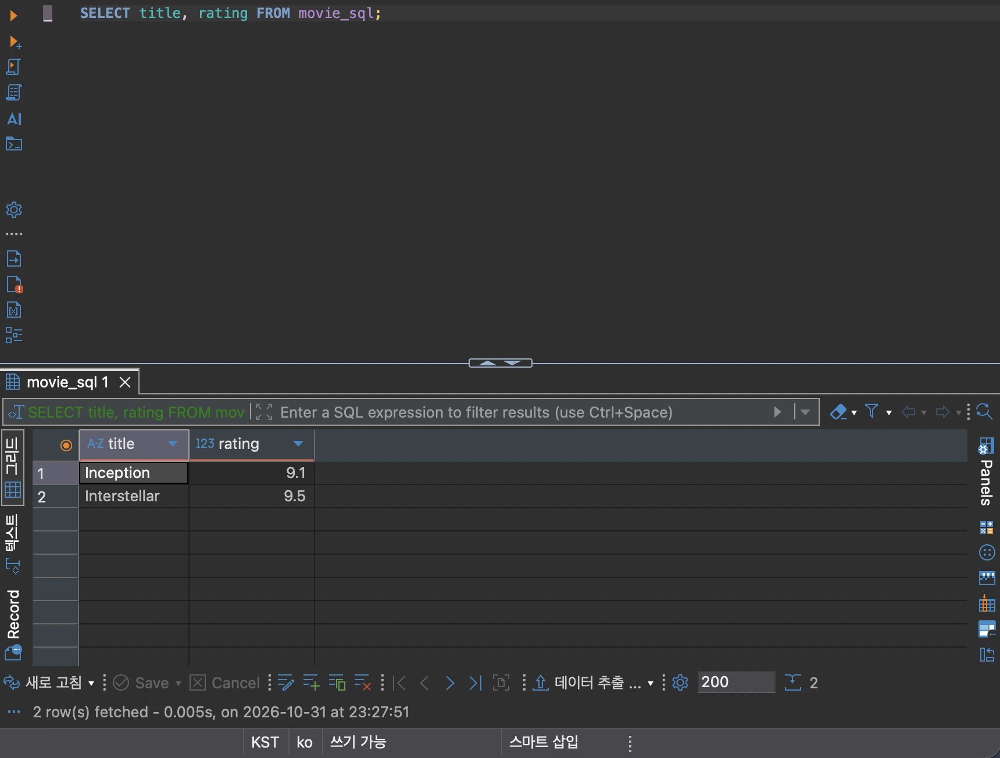
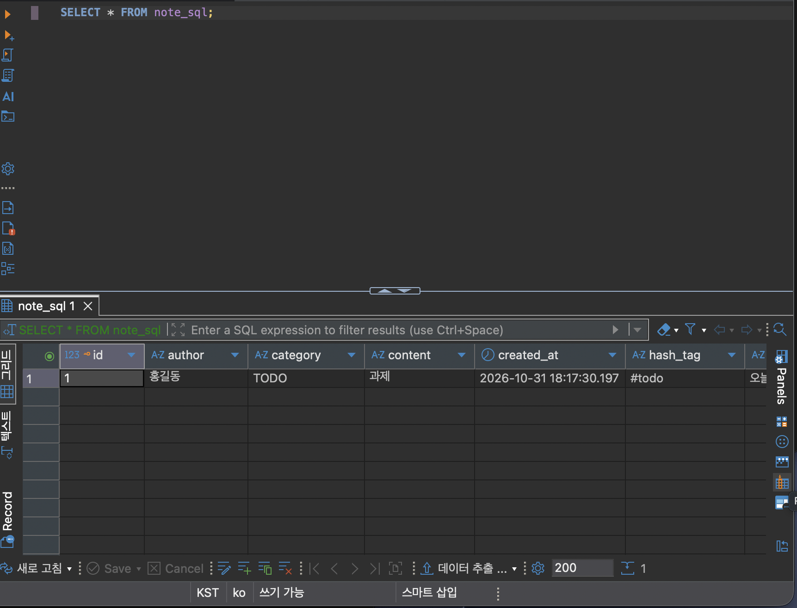

# week9 - Note REST CRUD (Spring Data JPA + MariaDB)

- **Render Deployment URL**: https://two026webservice-assign09.onrender.com
- **GitHub Repository URL (Organization)**: https://github.com/2026-2-WebService/assign09-c01-22300378
- **GitHub Repository URL (Personal)**: https://github.com/ggm77/2026WebService_assign09.git

## ① 프로젝트 소개

### 주제 및 주요 기능
간단한 메모(Note)를 등록·조회·수정·삭제하는 REST API 서버입니다.
기존의 Memory Repository 대신 Spring Data JPA로 실제 MariaDB에 데이터를 저장합니다.

- 메모 등록 / 전체 조회 / 단건 조회 / 수정 / 삭제
- 존재하지 않는 id 요청 시 404, 필수 값이 빠진 요청 시 400 응답
- 등록 시각(`createdAt`)은 JPA Auditing으로 자동 저장

### Entity 필드 구조
| 필드 | 타입 | 제약 | 설명 |
|---|---|---|---|
| id | Long | PK, AUTO_INCREMENT | 메모 번호 |
| title | String | NOT NULL, 100자 | 제목 |
| content | String | NOT NULL, 2048자 | 본문 |
| author | String | NOT NULL, 100자 | 작성자 |
| category | String | NOT NULL, 100자 | 분류 |
| hashTag | String | 100자 | 해시태그 |
| createdAt | Instant | NOT NULL | 등록 시각 (자동 저장) |

### 프로젝트 구조
```
src/main/java/com/seohamin/week9
├── Week9Application.java              # @EnableJpaAuditing
├── domain
│   ├── controller/NoteController.java # REST API
│   ├── service/NoteService.java       # 비즈니스 로직, 검증
│   ├── repository/NoteRepository.java # JpaRepository<Note, Long>
│   ├── model/Note.java                # @Entity (note_sql 테이블)
│   └── dto/NoteRequest.java, NoteResponse.java
└── global/exception
    ├── CustomException.java
    ├── constant/ExceptionCode.java    # INVALID_REQUEST(400), ID_NOT_FOUND(404)
    ├── handler/CustomizedResponseEntityExceptionHandler.java
    └── response/ExceptionResponse.java
```

요청 흐름: `Controller → Service → JpaRepository → Hibernate → MariaDB`

### 개발환경
- JDK 17, Gradle
- Spring Boot 4.1.2 (Spring Web MVC, Spring Data JPA)
- MariaDB (MariaDB JDBC Driver)
- IntelliJ IDEA, DBeaver, Docker, Render

## ② Database SQL Practice

### 기존 Table(book) 조회 및 데이터 추가
지난 수업에서 만든 `book` 테이블을 조회한 결과 4건이 있었습니다.
```sql
SELECT * FROM book;
```


데이터 1건을 추가했습니다. `id`는 AUTO_INCREMENT, `created_at`은 기본값 `CURRENT_TIMESTAMP`로 자동 입력됩니다.
```sql
INSERT INTO book(title, author, price, category)
VALUES ('JPA Programming', 'Kim', 38000, 'Programming');
```


다시 조회하면 id 6 데이터가 추가된 것을 확인할 수 있습니다.


### 새 Table 생성 SQL
```sql
CREATE TABLE movie_sql (
    id BIGINT AUTO_INCREMENT PRIMARY KEY,
    title VARCHAR(100) NOT NULL,
    director VARCHAR(100),
    genre VARCHAR(50),
    rating DOUBLE
);
```


DDL이라 `Updated Rows`는 0으로 표시됩니다.

### INSERT
```sql
INSERT INTO movie_sql(title, director, genre, rating)
VALUES ('Inception', 'Nolan', 'SF', 9.1),
       ('Interstellar', 'Nolan', 'SF', 9.3),
       ('Parasite', 'Bong', 'Drama', 9.0);
```


| id | title | director | genre | rating |
|---|---|---|---|---|
| 1 | Inception | Nolan | SF | 9.1 |
| 2 | Interstellar | Nolan | SF | 9.3 |
| 3 | Parasite | Bong | Drama | 9.0 |



### UPDATE
```sql
UPDATE movie_sql SET rating = 9.5 WHERE title = 'Interstellar';
```


Interstellar의 rating이 9.3 → 9.5로 변경되었습니다.


### DELETE
```sql
DELETE FROM movie_sql WHERE title = 'Parasite';
```


Parasite가 삭제되어 2건만 남았습니다.


### SELECT
```sql
SELECT * FROM movie_sql;
```
| id | title | director | genre | rating |
|---|---|---|---|---|
| 1 | Inception | Nolan | SF | 9.1 |
| 2 | Interstellar | Nolan | SF | 9.5 |

```sql
SELECT title, rating FROM movie_sql;
```


```sql
SELECT * FROM movie_sql WHERE genre = 'SF';
```


Parasite(Drama)가 이미 삭제되어 전체 조회와 결과가 같습니다.

## ③ Spring Data JPA 구현

### Entity 및 JpaRepository
`Note` 엔티티는 `note_sql` 테이블과 매핑됩니다. (SQL 실습 테이블 `movie_sql`과 다른 이름)

```java
public interface NoteRepository extends JpaRepository<Note, Long> {
}
```
`JpaRepository<Note, Long>`을 상속하는 것만으로 `save()`, `findAll()`, `findById()`, `existsById()`, `deleteById()`를 사용할 수 있습니다. 구현 클래스는 Spring Data JPA가 실행 시점에 자동으로 만들어 줍니다.

### 사용한 Annotation의 역할
| Annotation | 역할 |
|---|---|
| `@Entity` | 클래스를 JPA가 관리하는 엔티티로 지정 |
| `@Table(name = "note_sql")` | 매핑할 테이블 이름 지정 |
| `@Id` | 기본 키(PK) 필드 지정 |
| `@GeneratedValue(strategy = IDENTITY)` | PK 생성을 DB의 AUTO_INCREMENT에 맡김 |
| `@Column(length, nullable)` | 컬럼 길이와 NOT NULL 여부 지정 |
| `@EntityListeners(AuditingEntityListener.class)` | 엔티티 저장 시점에 Auditing 이벤트 처리 |
| `@CreatedDate` | 최초 저장 시각을 자동으로 채움 |
| `@EnableJpaAuditing` | JPA Auditing 기능 활성화 |
| `@RestController`, `@RequestMapping` | REST API 컨트롤러, 공통 경로 `/api/v1` |
| `@RequestBody`, `@PathVariable` | 요청 JSON → DTO 변환, URL 경로의 id 바인딩 |
| `@RestControllerAdvice`, `@ExceptionHandler` | 예외를 공통 JSON 응답으로 변환 |

### REST API Endpoint
| Method | URL | 설명 | 성공 응답 |
|---|---|---|---|
| POST | /api/v1/notes | 메모 등록 | 200 + NoteResponse |
| GET | /api/v1/notes | 전체 조회 | 200 + NoteResponse 배열 |
| GET | /api/v1/notes/{id} | 단건 조회 | 200 + NoteResponse |
| PUT | /api/v1/notes/{id} | 메모 전체 수정 | 200 + NoteResponse |
| DELETE | /api/v1/notes/{id} | 메모 삭제 | 204 No Content |

**요청 JSON (POST, PUT)** — 5개 필드 모두 필수
```json
{
  "title": "Render 배포 테스트",
  "content": "배포 URL에서 등록한 메모",
  "author": "seohamin",
  "category": "test",
  "hashTag": "#render"
}
```

**응답 JSON**
```json
{
  "id": 2,
  "title": "Render 배포 테스트",
  "content": "배포 URL에서 등록한 메모",
  "author": "seohamin",
  "category": "test",
  "hashTag": "#render",
  "createdAt": "2026-10-31T18:20:54.121547912Z"
}
```
`createdAt`은 `Instant` 타입이라 UTC로 저장·응답됩니다. (한국 시간 2026-11-01 03:20:54)

**오류 응답 JSON**
| 상황 | status | code |
|---|---|---|
| 필수 값 누락·빈 문자열 | 400 | INVALID_REQUEST |
| 존재하지 않는 id | 404 | ID_NOT_FOUND |

```json
{
  "timestamp": "2026-10-31T18:21:07.304178157Z",
  "status": "404 NOT_FOUND",
  "code": "ID_NOT_FOUND",
  "message": "아이디를 찾을 수 없습니다."
}
```

### JPA Entity와 MariaDB Table 비교
Spring Boot의 기본 네이밍 전략에 따라 camelCase 필드가 snake_case 컬럼으로 바뀝니다.

| Entity 필드 | Table 컬럼 | 비고 |
|---|---|---|
| id | id | bigint, PK, auto_increment |
| title | title | varchar(100) not null |
| content | content | varchar(2048) not null |
| author | author | varchar(100) not null |
| category | category | varchar(100) not null |
| hashTag | hash_tag | varchar(100) |
| createdAt | created_at | datetime(6) not null |

실제 생성된 컬럼(`hash_tag`, `created_at` 등)은 아래 ⑤ MariaDB 데이터 저장 확인 화면에서 볼 수 있습니다.

## ④ JPA와 SQL 비교

### JpaRepository 메서드 사용 결과
| 메서드 | 사용 위치 | 실행되는 SQL |
|---|---|---|
| `save()` | 등록 | INSERT |
| `findAll()` | 전체 조회 | SELECT (전체) |
| `findById()` | 단건 조회, 수정 | SELECT ... WHERE id = ? |
| `existsById()` | 삭제 전 존재 확인 | SELECT ... WHERE id = ? |
| `deleteById()` | 삭제 | SELECT 후 DELETE |
| `findById()` 후 값 변경 | 수정 | UPDATE |

수정 API는 `findById()`로 가져온 엔티티의 값을 바꾸는 방식으로 구현했고, 실행하면 Hibernate가 UPDATE SQL을 실행합니다.

### 실제 Hibernate SQL
`spring.jpa.show-sql=true` 설정으로 출력된 SQL입니다. (Render 로그, ⑤ 배포 URL CRUD 테스트 실행 시)

**애플리케이션 최초 실행 — `ddl-auto=update`로 테이블 자동 생성**
```sql
Hibernate: create table note_sql (id bigint not null auto_increment, author varchar(100) not null, category varchar(100) not null, content varchar(2048) not null, created_at datetime(6) not null, hash_tag varchar(100), title varchar(100) not null, primary key (id)) engine=InnoDB
```

**CRUD 요청별 SQL**

| 요청 | JpaRepository | Hibernate SQL |
|---|---|---|
| `POST /api/v1/notes` | `save()` | `insert into note_sql (author,category,content,created_at,hash_tag,title) values (?,?,?,?,?,?)` |
| `GET /api/v1/notes` | `findAll()` | `select n1_0.id,n1_0.author,n1_0.category,n1_0.content,n1_0.created_at,n1_0.hash_tag,n1_0.title from note_sql n1_0` |
| `GET /api/v1/notes/2` | `findById()` | `select ... from note_sql n1_0 where n1_0.id=?` |
| `PUT /api/v1/notes/2` | `findById()` | `select ... from note_sql n1_0 where n1_0.id=?` |
| | 값 변경 | `update note_sql set author=?,category=?,content=?,created_at=?,hash_tag=?,title=? where id=?` |
| `DELETE /api/v1/notes/2` | `existsById()` | `select count(*) from note_sql n1_0 where n1_0.id=?` |
| | `deleteById()` | `select ... from note_sql n1_0 where n1_0.id=?` |
| | | `delete from note_sql where id=?` |
| `POST` (필수 값 누락) | — | SQL 없음 (서비스에서 검증 후 400 응답) |

- `deleteById()`는 내부에서 먼저 `findById()`로 조회한 뒤 DELETE를 실행해서, 삭제 한 번에 SELECT가 2번(`existsById` + 내부 조회) 실행됩니다.
- 수정 시 바뀐 컬럼만이 아니라 모든 컬럼을 UPDATE합니다.
- 필수 값이 빠진 요청은 DB에 가기 전에 서비스에서 막히므로 SQL이 실행되지 않습니다.

### SQL 직접 작성 방식과 JPA 방식의 차이
| | SQL 직접 작성 | JPA |
|---|---|---|
| 작성 대상 | 테이블과 SQL 문 | 객체(Entity)와 메서드 호출 |
| 테이블 생성 | `CREATE TABLE` 직접 실행 | `ddl-auto=update`로 Entity 기준 자동 생성 |
| CRUD | INSERT/SELECT/UPDATE/DELETE 직접 작성 | `save()`, `findById()` 등 메서드 호출 |
| 수정 | `UPDATE ... SET ... WHERE` | 엔티티 값 변경 → UPDATE 자동 실행 |
| 장점 | 실행되는 쿼리를 정확히 제어 | 반복 SQL이 줄고 객체 중심으로 개발 |
| 주의점 | 반복 코드가 많음 | 실제 실행 SQL을 로그로 확인해야 함 |

## ⑤ 배포 및 환경 설정

### 환경변수
`application.properties`에는 실제 값 대신 환경변수만 사용합니다.
```properties
spring.datasource.url=${DB_URL}
spring.datasource.username=${DB_USERNAME}
spring.datasource.password=${DB_PASSWORD}
spring.datasource.driver-class-name=org.mariadb.jdbc.Driver
spring.jpa.hibernate.ddl-auto=update
spring.jpa.show-sql=true
server.port=${PORT:8080}
```

| 변수명 | 설정 위치 |
|---|---|
| `DB_URL` | IntelliJ Run Configuration, Render Environment |
| `DB_USERNAME` | IntelliJ Run Configuration, Render Environment |
| `DB_PASSWORD` | IntelliJ Run Configuration, Render Environment |

- IntelliJ: Run → Edit Configurations → Environment variables에 등록
- Render: 서비스의 Environment 탭에 등록

### Render 배포 과정
Dockerfile로 빌드와 실행을 분리했습니다.
```dockerfile
FROM eclipse-temurin:17-jdk AS builder
WORKDIR /app
COPY . .
RUN chmod +x ./gradlew && ./gradlew clean bootJar -x test --no-daemon

FROM eclipse-temurin:17-jre
WORKDIR /app
COPY --from=builder /app/build/libs/*-SNAPSHOT.jar /app/app.jar
ENTRYPOINT ["java", "-jar", "/app/app.jar"]
```
1. GitHub에 프로젝트 Push
2. Render에서 New → Web Service → GitHub 레포 연결
3. Runtime: Docker 선택
4. Environment에 `DB_URL`, `DB_USERNAME`, `DB_PASSWORD` 등록
5. 배포 후 로그에서 서버 기동 확인

### 배포 URL CRUD 테스트 결과
배포 URL(`https://two026webservice-assign09.onrender.com/api/v1/notes`)에 curl로 요청한 결과입니다.

| 순서 | 요청 | HTTP | 결과 |
|---|---|---|---|
| 1 | `POST /api/v1/notes` | 200 | id 2 등록 |
| 2 | `GET /api/v1/notes` | 200 | id 1, 2 조회 |
| 3 | `GET /api/v1/notes/2` | 200 | id 2 조회 |
| 4 | `PUT /api/v1/notes/2` | 200 | title, content 수정 |
| 5 | `GET /api/v1/notes/2` | 200 | 수정된 값 확인 |
| 6 | `DELETE /api/v1/notes/2` | 204 | 삭제 |
| 7 | `GET /api/v1/notes/2` | 404 | `ID_NOT_FOUND` |
| 8 | `GET /api/v1/notes/9999` | 404 | `ID_NOT_FOUND` (없는 id) |
| 9 | `POST` (title만 전송) | 400 | `INVALID_REQUEST` (필수 값 누락) |

**1. 등록**
```bash
curl -X POST https://two026webservice-assign09.onrender.com/api/v1/notes \
  -H 'Content-Type: application/json' \
  -d '{"title":"Render 배포 테스트","content":"배포 URL에서 등록한 메모","author":"seohamin","category":"test","hashTag":"#render"}'
```
```json
{"id":2,"title":"Render 배포 테스트","content":"배포 URL에서 등록한 메모","author":"seohamin","category":"test","hashTag":"#render","createdAt":"2026-10-31T18:20:54.121547912Z"}
```

**4. 수정**
```bash
curl -X PUT https://two026webservice-assign09.onrender.com/api/v1/notes/2 \
  -H 'Content-Type: application/json' \
  -d '{"title":"Render 배포 테스트 (수정)","content":"PUT으로 수정한 메모","author":"seohamin","category":"test","hashTag":"#render"}'
```
```json
{"id":2,"title":"Render 배포 테스트 (수정)","content":"PUT으로 수정한 메모","author":"seohamin","category":"test","hashTag":"#render","createdAt":"2026-10-31T18:20:54.121547Z"}
```

**6~7. 삭제 후 조회**
```bash
curl -X DELETE https://two026webservice-assign09.onrender.com/api/v1/notes/2   # HTTP 204
curl https://two026webservice-assign09.onrender.com/api/v1/notes/2
```
```json
{"timestamp":"2026-10-31T18:21:06.292695458Z","status":"404 NOT_FOUND","code":"ID_NOT_FOUND","message":"아이디를 찾을 수 없습니다."}
```

### MariaDB 데이터 저장 확인
```sql
SELECT * FROM note_sql;
```


DBeaver에서 조회한 id 1 데이터가 배포 URL의 전체 조회(위 표 2번)에서도 그대로 조회되어, Render 서버가 같은 MariaDB에 연결되어 데이터를 저장·조회하는 것을 확인했습니다.

### 발생한 문제와 해결 방법
| 문제 | 원인 | 해결 |
|---|---|---|
| 등록 요청 body가 DTO에 바인딩되지 않음 | 파라미터에 `@RequestBody` 대신 `@RequestMapping`을 붙임 | `@RequestBody`로 수정 |
| 등록 시 `createdAt`이 채워지지 않음 | `@CreatedDate`만 붙이고 Auditing을 켜지 않음 | `@EnableJpaAuditing`, `@EntityListeners(AuditingEntityListener.class)` 추가 |
| 없는 id를 삭제해도 오류가 나지 않음 | `deleteById()`는 대상이 없으면 아무 일도 하지 않음 | `existsById()`로 먼저 확인 후 404 응답 |
| 수정 API가 값을 바꾸지 않음, PATCH로 구현됨 | 조회 후 값을 바꾸지 않고 반환만 함 | PUT으로 변경, 5개 필드 검증 후 전체 수정 |

## ⑥ Weekly Report

### Key Learning
1. **JpaRepository만으로 CRUD가 된다**
   `NoteRepository`는 메서드를 하나도 작성하지 않았는데 `save()`, `findById()`, `deleteById()`를 바로 쓸 수 있었습니다. 구현체는 Spring Data JPA가 실행 시점에 만들어 주고, 실제 SQL은 Hibernate가 생성합니다. `show-sql` 로그로 메서드 호출이 어떤 SQL로 바뀌는지 직접 확인할 수 있었습니다.
2. **Entity 클래스가 곧 테이블 설계가 된다**
   SQL 실습에서는 `CREATE TABLE`을 직접 썼지만, JPA에서는 `ddl-auto=update` 설정으로 `Note` 클래스를 기준으로 `note_sql` 테이블이 자동 생성되었습니다. `@Column(length, nullable)`이 컬럼 길이와 NOT NULL로, `hashTag` 같은 camelCase 필드가 `hash_tag` 같은 snake_case 컬럼으로 바뀌는 것을 DBeaver에서 확인했습니다.
3. **DB 접속 정보는 코드가 아니라 환경변수로 관리한다**
   `application.properties`에는 `${DB_URL}` 같은 자리만 두고, 실제 값은 로컬에서는 IntelliJ Run Configuration, 배포 환경에서는 Render Environment에 넣었습니다. 같은 코드를 GitHub에 올려도 계정 정보가 노출되지 않고, 실행 환경마다 다른 DB를 연결할 수 있습니다.

### Problem & Solution
**문제: 등록 시각(`createdAt`)이 저장되지 않음**

`createdAt` 필드에 `@CreatedDate`를 붙였지만 값이 채워지지 않았습니다. 이 컬럼은 `nullable = false`라서 값이 없으면 등록 자체가 정상적으로 처리되지 않습니다.

**원인**
`@CreatedDate`는 표시만 해 두는 Annotation이고, 실제로 값을 넣어 주는 것은 JPA Auditing 기능입니다. Auditing을 켜지 않았고, 엔티티에 Auditing 이벤트를 받을 리스너도 등록하지 않았습니다.

**해결**
- `Week9Application`에 `@EnableJpaAuditing` 추가 → Auditing 기능 활성화
- `Note`에 `@EntityListeners(AuditingEntityListener.class)` 추가 → 저장 직전에 `createdAt`을 채움

수정 후 등록하면 응답과 DB의 `created_at`에 등록 시각이 들어가는 것을 확인했습니다.

### Code Review
`Note` Entity의 핵심 코드입니다.
```java
@Entity
@Table(name = "note_sql")
@EntityListeners(AuditingEntityListener.class)
public class Note {
    @Id
    @GeneratedValue(strategy = GenerationType.IDENTITY)
    private Long id;

    @Column(length = 100, nullable = false)
    private String title;

    @Column(length = 2048, nullable = false)
    private String content;

    // author, category, hashTag 생략

    @CreatedDate
    @Column(nullable = false)
    private Instant createdAt;
}
```
1. `@Entity`, `@Table(name = "note_sql")`로 이 클래스가 `note_sql` 테이블과 매핑됩니다. SQL 실습 테이블 `movie_sql`과 이름을 다르게 했습니다.
2. `@Id`, `@GeneratedValue(strategy = IDENTITY)`로 id는 MariaDB의 AUTO_INCREMENT가 자동으로 붙입니다. 그래서 등록 요청에는 id를 보내지 않습니다.
3. `@Column(length = 100, nullable = false)`가 테이블의 `varchar(100) not null` 컬럼이 됩니다.
4. `@CreatedDate`와 `@EntityListeners(AuditingEntityListener.class)`로 처음 저장될 때 `createdAt`에 현재 시각이 자동으로 들어갑니다.

### AI Usage
- SQL 실습(STEP 1~2) 진행 순서 안내, 스크린샷 자르기·정리
- PATCH → PUT 변경 시 서비스 코드 예시, 수정 API 검증 누락 리뷰
- README 초안 작성
- 직접 수정·검증한 부분
  - Entity, Repository, DTO, Service, Controller, 예외 처리, Dockerfile 구현
  - `@RequestBody` 누락, Auditing 미설정, 없는 id 삭제 처리 버그 수정
  - AI가 준 PUT 예시를 참고해 수정 API를 직접 변경하고, 리뷰 내용(검증 누락)을 반영
  - DBeaver에서 SQL 실습을 직접 실행하고 결과 확인
- AI 사용률: 10%

### Reflection
- **Bean Validation:** 지금은 서비스에서 `if`문으로 필수 값을 검사하고 있어서 등록과 수정에 같은 코드가 반복됩니다. `@NotBlank`, `@Valid`를 사용해 DTO 단계에서 검증하는 방법을 공부하고 싶습니다.
- **테스트 코드:** 이번에는 Postman과 DBeaver로 직접 확인했는데, `@DataJpaTest`와 MockMvc로 CRUD와 오류 응답을 자동으로 검증하는 테스트를 작성해 보고 싶습니다.
- **JPQL과 쿼리 메서드:** `findByCategory()`처럼 메서드 이름으로 조회하는 방법과 `@Query`로 직접 쿼리를 작성하는 방법을 익혀 카테고리·해시태그 검색 기능을 추가해 보고 싶습니다.
