# week10

## ① 프로젝트 소개

### 프로젝트 주제 및 주요 기능
9주차에 만들었던 메모 API에 이번 주에 배운 JPA 기능들을 추가했습니다.

- 메모 등록, 조회, 수정, 삭제 (9주차 기능)
- Query Method로 메모 검색 (제목 검색, 작성자+분류 검색, 분류별 최신순 조회)
- 수정 기능을 Dirty Checking 방식으로 변경
- Auditing으로 생성 시간, 수정 시간 자동 저장

### Render Deployment URL
- https://two026webservice-assign10.onrender.com
### GitHub Repository URL (Organization)
- https://github.com/2026-2-WebService/assign10-c01-22300378.git
### GitHub Repository URL (Personal)
- https://github.com/ggm77/2026WebService_assign10.git
## ② 주요 구현 내용 및 결과

### Query Method 3개: 검색 조건 및 API 실행 결과
NoteRepository에 아래 3개 메서드를 추가했습니다.

1. `findByTitleContainingIgnoreCase` (단일 조건)
   - 제목에 keyword가 들어간 메모를 찾습니다. 대소문자는 구분 안 합니다.
   - `GET /api/v1/notes/search/title?keyword=spring`
2. `findByAuthorAndCategory` (복합 조건 - And)
   - 작성자랑 분류가 둘 다 같은 메모를 찾습니다.
   - `GET /api/v1/notes/search/author?author=seohamin&category=study`
3. `findByCategoryOrderByCreatedAtDesc` (정렬 - OrderBy Desc)
   - 분류가 같은 메모를 최신순으로 가져옵니다.
   - `GET /api/v1/notes/search/category?category=study`

파라미터를 안 보내거나 빈 값이면 400 에러(INVALID_REQUEST)가 나오고, 검색 결과가 없으면 빈 배열 `[]`이 나옵니다.

**테스트 데이터**

검색 결과가 잘 걸러지는지 보려고 메모 4개를 먼저 등록했습니다.

- 1번: Spring Boot 정리 / seohamin / study
- 2번: JPA 공부 / seohamin / study
- 3번: spring data jpa 메모 / kim / study
- 4번: 주말 계획 / seohamin / daily

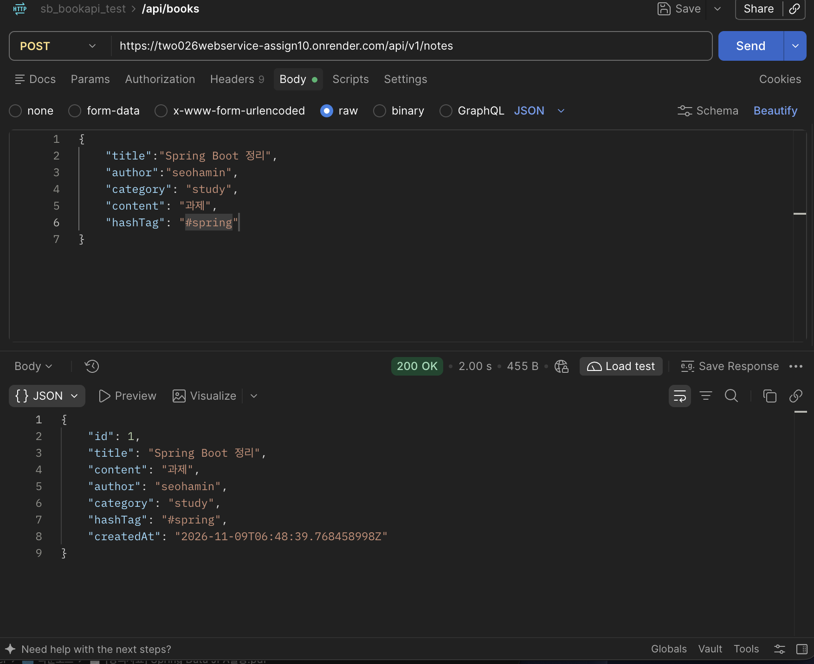
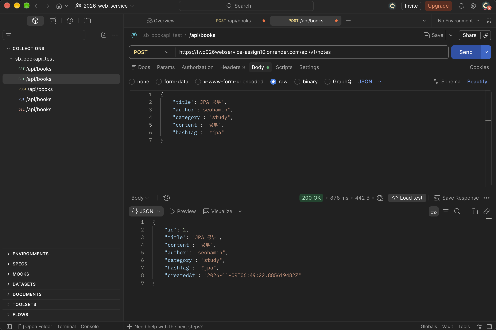
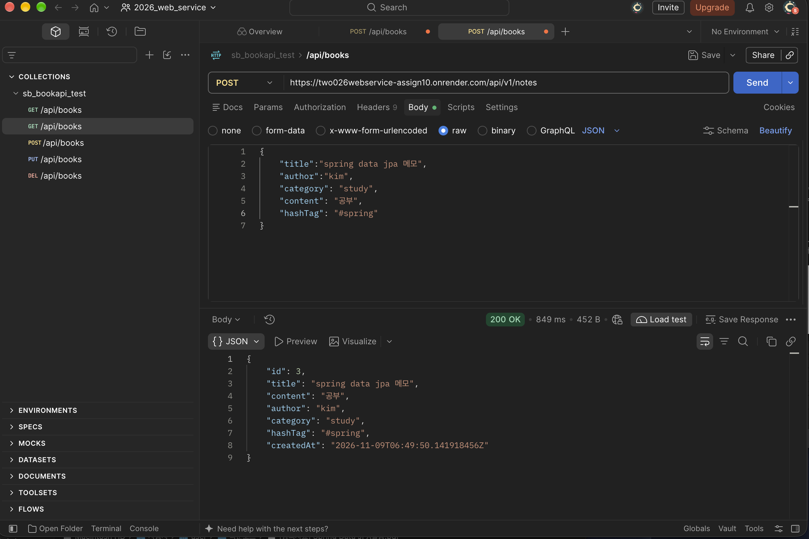
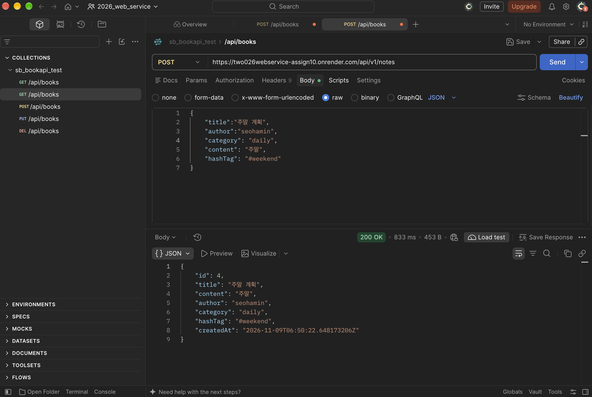

**제목 검색 결과** - keyword=spring

1번(Spring Boot 정리)이랑 3번(spring data jpa 메모)이 나왔습니다. 대문자 Spring, 소문자 spring 둘 다 나와서 IgnoreCase가 잘 된 걸 확인했습니다.

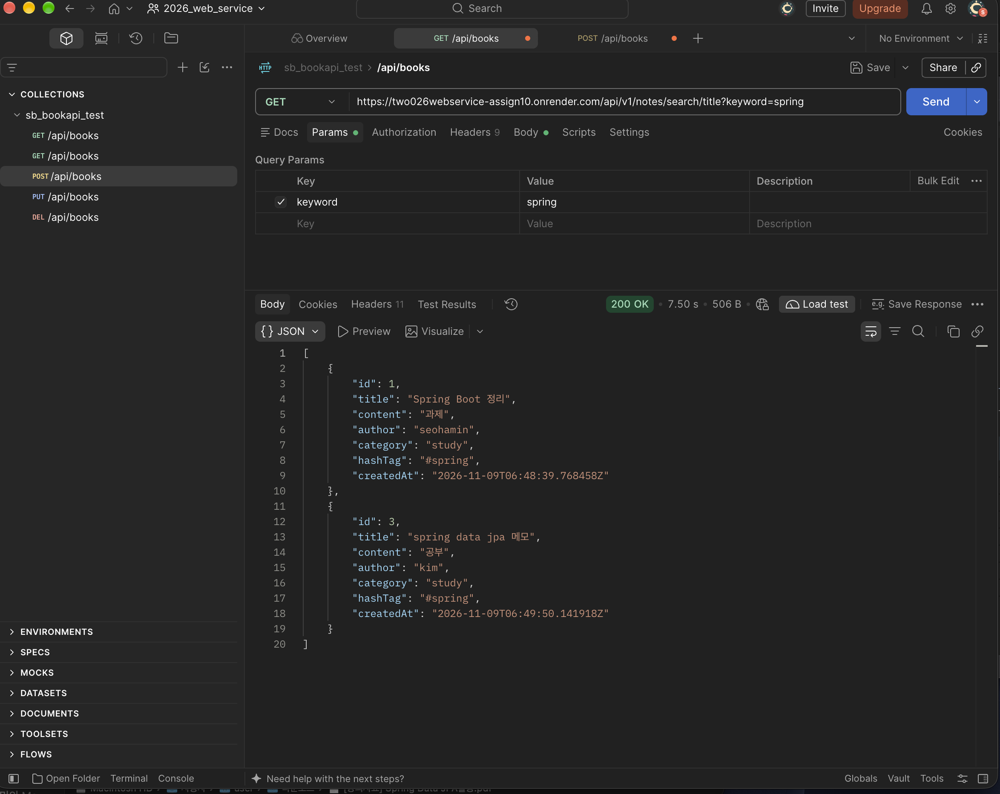

**작성자 + 분류 검색 결과** - author=seohamin, category=study

1번, 2번만 나왔습니다. 3번은 작성자가 kim이라서, 4번은 분류가 daily라서 빠졌습니다.

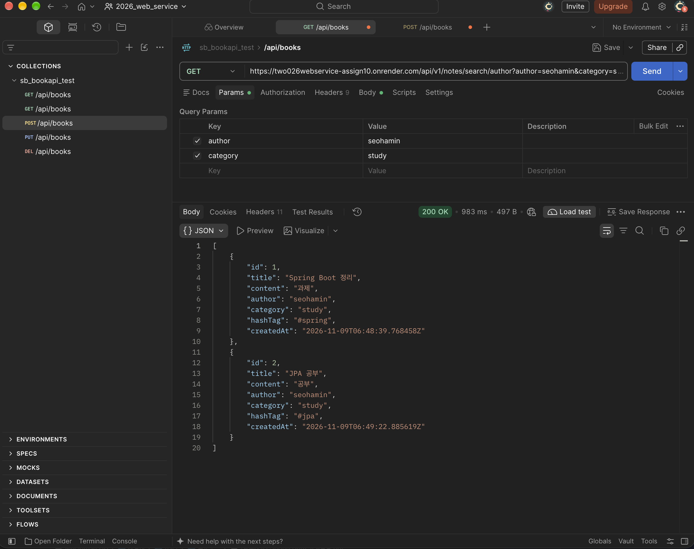

**분류별 최신순 조회 결과** - category=study

study인 메모가 3번 → 2번 → 1번 순서로, 나중에 만든 게 먼저 나왔습니다.

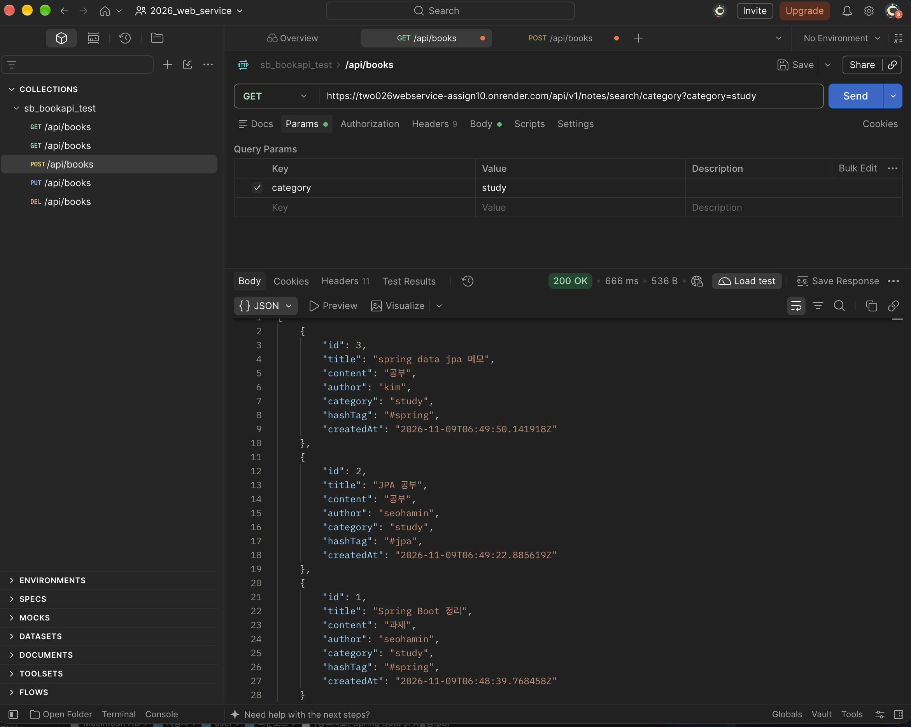


### Dirty Checking: 수정 기능 구현 및 실행 결과
9주차에 배운 방식은 값을 바꾼 다음에 `noteRepository.save(note)`를 호출해서 수정하는 방식이었는데, 이번에는 `@Transactional`을 붙이고 save()를 지웠습니다.

```java
@Transactional
public NoteResponse updateNote(final NoteRequest noteRequest, final Long id) {
    // 입력값 검사 부분은 생략

    final Note note = noteRepository.findById(id)
            .orElseThrow(() -> new CustomException(ExceptionCode.ID_NOT_FOUND));

    note.updateTitle(noteRequest.title());
    note.updateContent(noteRequest.content());
    note.updateAuthor(noteRequest.author());
    note.updateCategory(noteRequest.category());
    note.updateHashTag(noteRequest.hashTag());

    return NoteResponse.of(note); // save() 없음
}
```

메서드에 트랜잭션 어노테이션이 달려있기 때문에 findById()로 가져온 엔티티를 트랜잭션이 커밋될 때 JPA가 처음 값이랑 비교해서 바뀐 게 있으면 UPDATE를 날려줍니다.

**DBeaver 수정 전** - id 1번 데이터

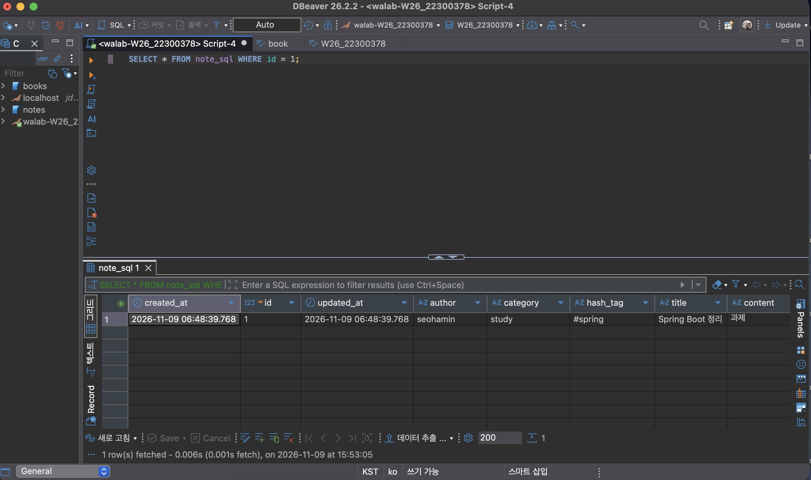

**Postman으로 PUT 요청** - title, content 수정

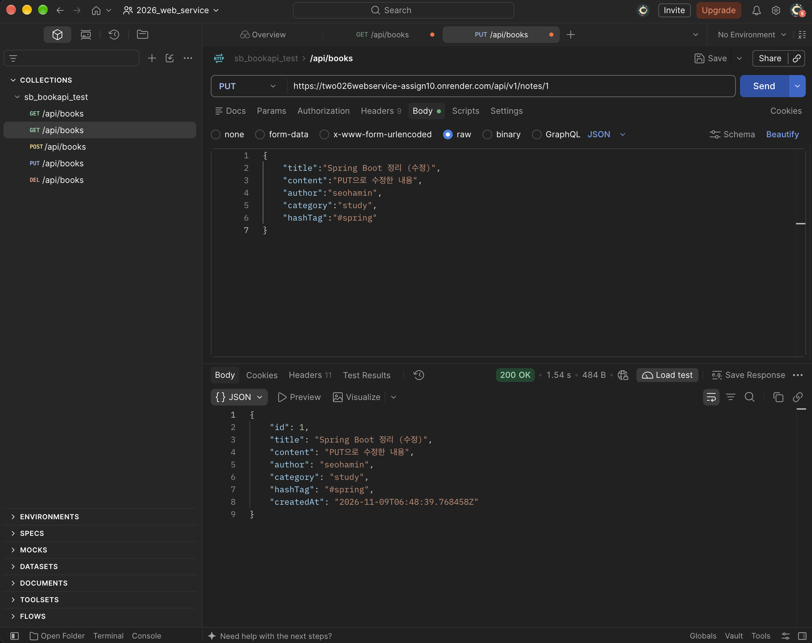

**DBeaver 수정 후**

title이 `Spring Boot 정리 (수정)`, content가 `PUT으로 수정한 내용`으로 바뀌었습니다. save()를 안 불렀는데도 DB에 반영된 걸 확인했습니다.

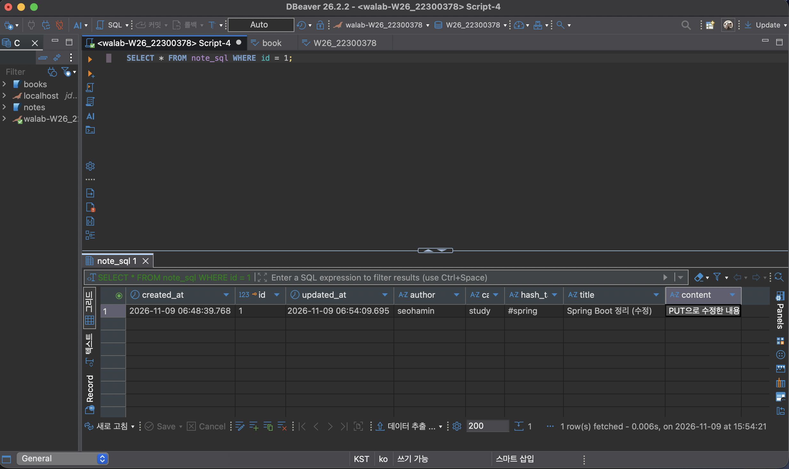

### Auditing: 생성·수정 시간 자동 기록 결과
`@CreatedDate`(createdAt)는 9주차에 이미 해놨어서, 이번에는 `@LastModifiedDate`를 붙인 updatedAt만 추가했습니다. `@EnableJpaAuditing`이랑 `@EntityListeners(AuditingEntityListener.class)`도 9주차에 설정해둔 걸 그대로 썼습니다.

```java
@CreatedDate
@Column(nullable = false)
private Instant createdAt;

@LastModifiedDate
@Column(nullable = false)
private Instant updatedAt;
```

- createdAt: 처음 저장될 때 시간이 들어감
- updatedAt: 저장될 때랑 수정될 때마다 시간이 바뀜

**등록 직후** - 4개 다 created_at이랑 updated_at이 같음

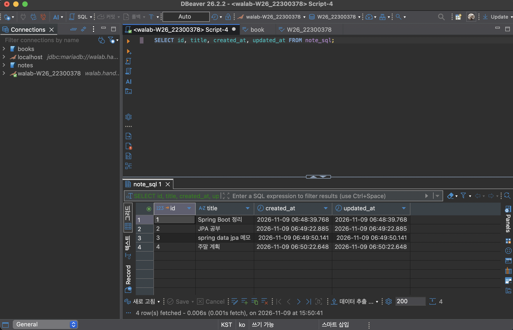

**1번 수정 후** - 1번의 created_at은 06:48:39 그대로고, updated_at만 06:54:09로 바뀜. 수정 안 한 2~4번은 그대로임

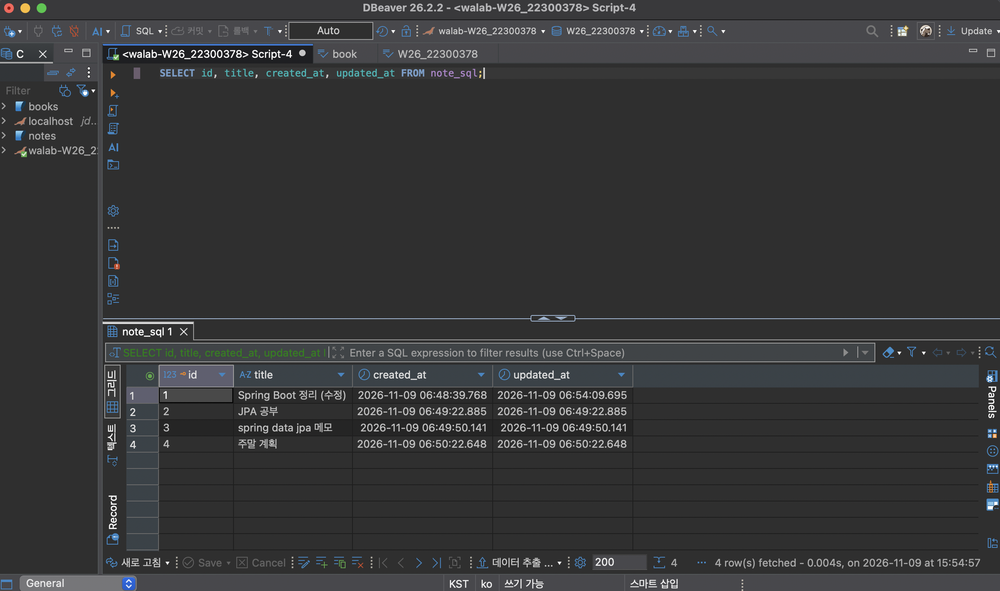

DB에 저장된 시간은 UTC라서 한국 시간보다 9시간 느리게 나옵니다.

**직접 입력하지 않아도 자동으로 기록 되는 이유** - `@EnableJpaAuditing`로 Auditing을 켰기 때문에 `AuditingEntityListener`가 `@PrePersist`와 `@PreUpdate`를 통해 자동으로 `createdAt`과 `updatedAt`이 바뀝니다. `@PrePersist` 때는 둘 다 값이 바뀌고, `@PreUpdate` 때는 `updatedAt`만 바뀝니다.

## ③ Weekly Review

### Key Learning: 새롭게 배운 내용 2~3가지
- 메서드 이름을 통해 JPA가 SQL을 만들어준다는 게 신기했습니다. Containing은 LIKE, IgnoreCase는 UPPER, OrderBy...Desc는 ORDER BY DESC로 바뀌는 걸 콘솔 로그로 확인했습니다.
- 트랜잭션과 영속성 컨텍스트의 동작 방식을 알게되었습니다. 어떤 시점에 값을 확인하고, 어떤 시점에 SQL문이 실행 되는지 알게되었습니다.
- 어노테이션만 붙이면 생성 시간이랑 수정 시간이 자동으로 들어가서, 시간을 직접 넣는 코드를 안 써도 돼서 편했습니다.

### Problem & Solution: 어려웠던 점과 해결 방법
처음에 코드를 다 작성하고 배포 했을 때 모든 API에서 500 INTERNAL SERVER ERROR가 떴었습니다. 그래서 실제 로그를 뒤져보니 SQL문이 제대로 동작하지 않고 있다는걸 알게 되었습니다. 알고 보니 `updatedAt` 컬럼을 엔티티에 추가했고, `@LastModifiedDate`까지 달았는데 이게 `ddl-auto: update`에서 데이터가 존재하는 테이블에 NOT NULL 컬럼을 추가하지 못해 이런 문제가 생겼었습니다.
그래서 `ddl-auto: create`로 한번 프로젝트를 실행하여 테이블을 전부 날리고 다시 `ddl-auto: update`로 실행해서 테이블을 다시 만들었습니다.

### Reflection: 이번 과제를 통해 느낀 점
이번에 `ddl-auto: update`만 믿고 있다가 배포하자마자 모든 API가 500 에러가 나서 당황했습니다. 엔티티에 필드만 추가하면 테이블도 알아서 맞춰질 거라고 생각했는데, 이미 데이터가 들어있는 테이블에서는 그렇지 않다는걸 알게 되었습니다.
처음에는 코드에서 원인을 찾으려고 했는데, 로그를 보고 나서야 SQL 쪽 문제라는 걸 알 수 있었습니다. 앞으로는 에러가 나면 로그부터 먼저 확인해야겠다고 느꼈습니다.
그리고 이번에는 `ddl-auto: create`로 테이블을 날리고 다시 만들어서 해결했지만, 이렇게 하면 기존 데이터가 전부 사라집니다. 과제라서 괜찮았지만 실제 서비스였다면 문제였을 것 같습니다. 데이터를 지우지 않고 테이블 구조를 바꾸는 방법도 공부해 보고 싶습니다.

## ④ AI Usage

### 사용한 생성형 AI 도구 및 주요 질문
- Claude Code 사용
- STEP 2 주석 답 맞게 썼는지 확인
- 구현한 코드 검토 (파라미터 없을 때 500 나는 거 찾아줌)
- build 폴더 git 추적 해제

### AI가 제공한 내용 중 직접 수정하거나 검증한 부분
- STEP 2 주석은 피드백 받고 제가 직접 몇 번 고쳐서 썼습니다.
- Query Method, 검색 API, Dirty Checking 수정, Auditing 코드는 직접 짰습니다.
- 500 에러는 지적받고 required = false로 직접 고쳤고, 빈 값일 때 400으로 통일하는 건 제가 정했습니다.
- Postman이랑 DBeaver로 결과를 직접 확인했습니다.

### AI 사용 비율에 대한 자기 평가
- AI 사용률: 10%
